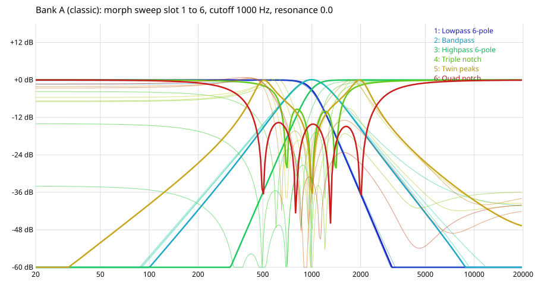
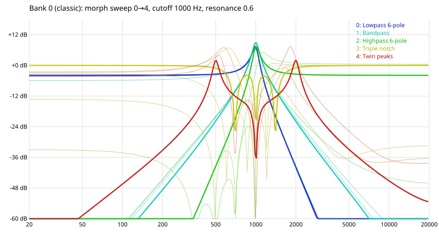
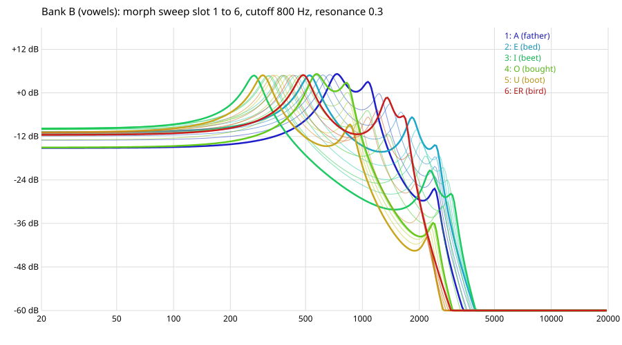

# Zeds Dead: a stereo morphing Z-plane filter

**Status: prototype.** It compiles for the RP2040 and the maths passes the PC test suite in `tools/`, but it has **not yet been tried on a real Workshop Computer**. Expect to tune it by ear.

Zeds Dead is a stereo multimode filter for the Music Thing Modular Workshop System Computer. It doesn't switch between lowpass, bandpass, highpass and so on: it **morphs** between them. All the way through the morph it stays a single filter, with its poles and zeros gliding smoothly across the *z-plane*. The idea comes from the "Z-plane" filters in E-mu's late-90s samplers and the Morpheus. This card is an original, much simpler take on it, written to be read and learned from.

---

## Controls

| Control | Function |
|---|---|
| **Main knob** | Cutoff frequency, 20 Hz to 18 kHz (exponential) |
| **Knob X** | **Morph**: glides through the 5 shapes of the current bank |
| **Knob Y** | Resonance |
| **Switch UP** | *Classic* bank: Lowpass → Bandpass → Highpass → Triple notch → Twin peaks |
| **Switch MIDDLE** | *Vowel* bank: A → E → I → O → U (set Main to about 800 Hz for natural vowels) |
| **Switch DOWN** (momentary) | Cycles the stereo spread mode: *linked* / *cutoff spread* / *morph spread* / *both* |
| **Audio In 1 / 2** | Left / right input. If only In 1 is patched, it feeds both sides. |
| **Audio Out 1 / 2** | Left / right output |
| **CV In 1** | Cutoff, 1 V/oct, added to Main. Uses the calibration stored on the module (see below). |
| **CV In 2** | Morph, added to X. 5 V covers the whole bank. Also calibrated. |
| **LEDs 0, 1** (top row) | Left / right output level |
| **LEDs 2 to 5** | A dot of light showing the morph position. For about 1 s after a DOWN press they show the spread mode instead. |

Patch ideas: put a slow LFO into CV 2 and sweep through the vowels. Turn on "morph spread" so the two channels sit at different points of the morph, for wide stereo from a mono source. Or feed an envelope to CV 1 and resonance up high on the Classic bank.

---

## Files

| File | What's in it |
|---|---|
| `zplane.h` | **All the maths.** Filter frames, the coefficient designer and the fixed-point biquad runner. Has no hardware code, so it compiles on a PC. |
| `main.cpp` | Hardware glue: knobs, jacks, LEDs, and how the two CPU cores cooperate. |
| `tools/host_test.cpp` | Runs on a PC. Checks stability and fixed-point accuracy, torture-tests fast modulation, and draws response plots as SVG. |
| `docs/*.svg` | Plots of the morph sweeps produced by the host test |
| `ComputerCard.h` | Chris Johnson's ComputerCard library (copied from `Demonstrations+HelloWorlds`) |

### Building

```sh
# Firmware (needs the Pico SDK 2.x and arm-none-eabi-gcc)
mkdir build && cd build
PICO_SDK_PATH=/path/to/pico-sdk cmake ..
make            # → zeds_dead.uf2, drag onto the Computer in BOOTSEL mode

# PC test bench (any C++17 compiler)
cd tools
g++ -O2 -std=c++17 -I.. host_test.cpp -o host_test && ./host_test
```

---

# How it works: a walkthrough of the maths

This section is for learners. It assumes you're comfortable with school algebra and know what a sine wave is. A few complex numbers turn up, but you only need the picture: a complex number is a point on a 2D plane, and multiplying by e^{jθ} rotates a point by angle θ.

## 1. Samples and delays

Inside the Computer, audio is a stream of numbers, 48 000 per second: x[0], x[1], x[2] and so on. A **digital filter** computes each output sample from the current input and a few *recent* inputs and outputs. The filter used everywhere in this card is the **biquad**:

```
y[n] = b0·x[n] + b1·x[n-1] + b2·x[n-2]  −  a1·y[n-1] − a2·y[n-2]
```

It needs only 5 numbers (b0, b1, b2, a1, a2), but by picking them carefully you can make a lowpass, highpass, bandpass, notch, resonant peak, or anything in between. The `a` terms feed **past outputs** back in. That feedback is what lets a filter *resonate* (ring). It's also what can make it *explode* if you get it wrong.

## 2. From the recipe to the transfer function

Write z⁻¹ to mean "delayed by one sample". The recipe above then becomes a fraction called the **transfer function**:

```
          b0 + b1·z⁻¹ + b2·z⁻²        N(z)    ← "numerator"  → ZEROS
  H(z) = ------------------------  =  ----
           1 + a1·z⁻¹ + a2·z⁻²        D(z)    ← "denominator" → POLES
```

Why bother? Because of one very useful fact. To find out what the filter does to a sine wave at frequency f, you set

```
  z = e^{jω},   where ω = 2π·f / 48000
```

and work out |H(z)|. That number is the filter's **gain** at that frequency. The values of z = e^{jω} all lie on a circle of radius 1, the **unit circle**:

```
                 Im
                  |      ω = π/2  (12 kHz)
               .--+--.
            .'    |    '.
  ω = π   |      |      |  ω = 0  (0 Hz, DC)
 (24 kHz) +------+------+---- Re
  Nyquist |      |      |
            '.    |    .'
               '--+--'
                  |      ω = −π/2
```

Walking anticlockwise around the top half of the circle, from angle 0 to angle π, is the same as sweeping a sine wave from 0 Hz up to 24 kHz. 24 kHz is the **Nyquist frequency**: half the sample rate, and the highest frequency that can exist at 48 kHz.

## 3. Poles and zeros: the geometric picture

Factor the top and bottom of H(z) and you get

```
           (1 − q1·z⁻¹)(1 − q2·z⁻¹)
  H(z) = g · ------------------------
           (1 − p1·z⁻¹)(1 − p2·z⁻¹)
```

The q's are the **zeros** and the p's are the **poles**. Both are just points on the z-plane. Here is the key intuition, which is worth drawing for yourself:

> **The gain at a frequency = (product of distances from that point on the circle to each zero) ÷ (product of distances to each pole).**

So:

* A **pole close to the circle** gives a tiny distance on the bottom of the fraction, so a big **peak** at that angle. The closer it is, the taller and narrower the peak.
* A **zero on the circle** gives zero distance on the top, so **silence** at that angle: a notch.
* A zero at angle 0 (z = +1) kills the low frequencies, which is the basis of a **highpass**. A zero at angle π (z = −1) kills Nyquist and the highs, the basis of a **lowpass**.

For real-valued audio, complex poles and zeros always come in **mirror pairs** above and below the horizontal axis. That's why one biquad holds exactly one pair of each.

### Stability

A pole at radius r makes the impulse response decay like rⁿ:

* **r < 1**: the ringing dies away, so the filter is **stable**.
* **r = 1**: it rings forever.
* **r > 1**: the ringing grows every sample until the numbers overflow. Bang.

**So: a filter is stable exactly when all its poles are inside the unit circle.** Keep that in mind; it's why we morph the way we do.

## 4. Placing the poles: frequency and Q

Musicians think in terms of **cutoff frequency f** and **resonance Q**. An analogue resonant filter with those settings has poles at

```
  s = −ω/(2Q)  ±  j·ω·√(1 − 1/(4Q²))        (ω = 2πf, the analogue "s-plane")
```

To get to the digital z-plane we use the mapping **z = e^{sT}**, where T = 1/48000 is the sample period. This is called *impulse invariance* or the *matched-z transform*. Since e^{a + jb} = eᵃ · e^{jb}, the real part of s turns into the **radius** and the imaginary part into the **angle**:

```
  radius  r = exp(−π·f / (Q·fs))
  angle   θ = (2π·f/fs) · √(1 − 1/(4Q²))
```

This is `placePole()` in `zplane.h`. Notice how well behaved it is:

* For any Q > 0, r is below 1, so **every pole we can place is stable.**
* As Q grows, r → 1 and the resonance gets sharper.
* As Q → 0, r → 0: the poles shrink to the centre of the circle, where they're the same distance from every point on it. They then **have no effect**. The frames use Q = 0 to mean "switch this section off", and morphing towards that grows or dissolves a resonance smoothly.

## 5. Placing the zeros: the "mode"

The zeros decide what *kind* of filter a section is. With a numerator n0 + n1·z⁻¹ + n2·z⁻²:

| Kind | (n0, n1, n2) | Zeros at | Effect |
|---|---|---|---|
| all-pole | (1, 0, 0) | none | pure resonance / formant |
| lowpass | (1, 2, 1) | z = −1 twice | silence at Nyquist |
| highpass | (1, −2, 1) | z = +1 twice | silence at DC |
| bandpass | (1, 0, −1) | z = +1 and −1 | silence at both ends |
| notch | (1, −2cos θ, 1) | e^{±jθ}, on the circle | silence at frequency θ |

Check one yourself: (1 + z⁻¹)² = 1 + 2z⁻¹ + z⁻², and it's zero when z = −1.

## 6. Cascades: building bigger filters from biquads

One biquad gives a 2-pole (12 dB/octave) filter. For steeper or more complex shapes we chain three, so audio goes through section 0, then 1, then 2. The total transfer function is the product H₀·H₁·H₂: **6 poles and 6 zeros** to place wherever we like. A steep 36 dB/octave lowpass is three lowpass sections at the same frequency with different Q values (here the textbook Butterworth values 0.518, 0.707 and 1.932). A vowel is three resonances at that vowel's formant frequencies.

Why not one big 6th-order equation? High-order direct forms are extremely sensitive to rounding: a tiny coefficient error can move a pole outside the circle. Cascaded biquads keep each pole pair under separate control, so they're far more robust. This is the standard practice.

## 7. Frames and morphing: the "Z-plane" idea

A **frame** is a complete recipe for the three sections. For each one it gives a pole frequency (as a ratio of the cutoff), a Q, and a zero type. A **bank** is an ordered list of 5 frames. Knob X selects a position like 2.3, meaning "30 % of the way from frame 2 to frame 3".

The naive way to morph would be to run all five filters and crossfade their *outputs*. That sounds like several filters mixed together: you hear phase cancellation and "double" peaks. Instead we **interpolate the filter itself**:

**Poles**: interpolated in polar form, using `designCascade()` step 2:

* Radius: linear, r = r_A + (r_B − r_A)·t. Both endpoints are below 1, so every in-between value is too. **The filter is guaranteed stable at every point of the morph.** This is the most important line in the card.
* Angle: geometric, θ = θ_A^(1−t)·θ_B^t. That's linear in *log-frequency*, which matches how we hear pitch. A formant gliding from 300 Hz to 2400 Hz passes 850 Hz at the halfway point, not 1350 Hz.

**Zeros**: here we interpolate the numerator coefficients directly. Zeros only appear in the numerator, so they **can't** cause instability, and the simplest method is fine. It also handles a bandpass's lone real zeros, which don't come in mirror pairs.

The **order of the frames** shapes the sound of the morph. In the Classic bank:

* **LP → BP**: the numerator goes from (1,2,1) to (1,0,−1). Halfway is (1,1,0), a single zero at Nyquist, which is a gentle lowpass. So you hear lowpass, then less low, then bandpass.
* **BP → HP**: halfway is (1,−1,0), a single zero at DC, which is a gentle highpass.
* **HP → Notch**: the zero pair *slides around the unit circle* from 0 Hz up to the cutoff. You can hear the notch sweep upward.
* **Notch → Twin peaks**: the side notches dissolve as two resonances grow either side of the centre notch.

## 8. Keeping the volume sensible

A resonant pole pair can have a gain of several hundred at its peak. Two normalisation steps keep that under control (`designCascade()` steps 4 and 5):

1. **Per section**: we measure the gain at DC, at Nyquist and at the pole angle (one of these is always roughly the loudest point of a biquad) and scale b0, b1, b2 so the peak is 1. Nothing can then overflow inside the cascade.
2. **Overall makeup**: we measure the whole cascade at the same probe points and set a gain that brings its peak back to 1. If we stopped there, turning up resonance would make everything *except* the peak quieter. So we let the peak rise by up to +12 dB, in proportion to resonance × "peakiness":

   ```
   peakiness = 1 − (gain at DC or Nyquist, whichever is louder) / (peak gain)
   ```

   A resonant lowpass gets the full boost. A notch, whose loudest region *is* its flat passband, gets none. A gentle cubic soft clipper then rounds off the hot peaks.

## 9. Fixed-point arithmetic: making it fast enough

The RP2040's Cortex-M0+ cores have **no floating-point hardware**. At 192 MHz there are 4000 clock cycles per sample, so we split the work:

* **Core 1** does all the float maths (`exp`, `cos`, `sqrt`, the normalisation) a few thousand times per second, and produces fresh coefficients.
* **Core 0** runs the 48 kHz audio callback using **integers only**.

Core 0 uses *fixed point*: we pretend there is a binary point at a fixed position inside an integer.

* **Coefficients are Q3.28.** The integer 2²⁸ = 268 435 456 stands for 1.0, and the range is about ±8.
* **Samples**: the 12-bit input (−2048 to 2047) is shifted left 12 bits, so full scale is ±2²³. That keeps 12 bits of extra precision *below* the input's smallest step, and leaves 8 bits (48 dB) of *headroom above* full scale for resonant peaks.
* Each product (24-bit sample × 30-bit coefficient) goes into a **64-bit accumulator**, and we shift right by 28 at the end.

Two classic tricks, both explained in the code comments:

* **Direct Form I** (separate input and output histories) copes well with coefficients that change every sample.
* **Error feedback**: shifting right throws away the low 28 bits of the result. For a sharp resonance at a low frequency, the feedback loop amplifies those rounding errors into audible hiss or "limit cycles". So we save the discarded bits and add them back next sample, and the errors cancel out over time.

## 10. Two cores sharing data safely

Core 1 writes coefficients and core 0 reads them, at the same time. If core 0 read an `a1` from the new design and an `a2` from the old one, that pair might be an unstable filter, even though both designs are stable on their own. So we use **double buffering**. There are two coefficient buffers: core 1 fills the one core 0 isn't using, then flips an index (with a memory barrier, `__dmb()`) to hand it over.

On core 0, every sample, each coefficient moves 1/32 of the way towards the latest target (`ProcessSample()` step 1). That removes zipper noise. It's safe because the region of stable (a1, a2) values for a biquad is a **triangle**, |a2| < 1 and |a1| < 1 + a2, and a triangle is *convex*: any blend of two points inside it stays inside it.

## 11. Stereo

The left and right channels are separate cascades, each with its own coefficients, which core 1 designs separately. In the spread modes the left channel gets a slightly lower cutoff and/or an earlier morph position, and the right channel slightly higher and/or later. Because the morph is continuous, this gives a wide, moving stereo image without any delay or chorus.

---

## CV calibration

Every Workshop Computer has a small EEPROM chip holding calibration data. The factory writes it, and you can redo it with the calibration mode of the Simple MIDI card (`releases/00_Simple_MIDI`). For each CV input it stores two numbers: the raw reading at 0 V (`adcOffset`), and how many millivolts one ADC step is worth (`mvPerAdcQ16`, in Q16 fixed point). ComputerCard loads them at power-up.

This card uses `CVIn1Millivolts()` and `CVIn2Millivolts()`, which apply

```
millivolts = (raw − adcOffset) × mvPerAdcQ16 / 65536
```

so that 1 V into CV In 1 really moves the cutoff by one octave. These two functions aren't in the stock ComputerCard library. They're a small local addition copied from Simple MIDI and marked at the top of `ComputerCard.h`, so re-add them if you update the library. An unplugged CV input is treated as exactly 0 V, because calibrating a raw reading of 0 would otherwise give a small offset voltage. If the EEPROM holds no valid data, ComputerCard falls back to an ideal ±6 V range.

## Testing on a PC

`tools/host_test.cpp` uses the exact same `zplane.h` code as the card:

```
[stability] 50220 designs checked, largest pole radius 0.999965
[accuracy] worst fixed-vs-float gain error 0.100 dB
[torture] 20 s fast modulation: peak 2048, 9.287% samples at full scale, silent tail 0
ALL CHECKS PASSED
```

It also writes the plots in `docs/`. They're a good way to learn: edit a frame in `zplane.h`, re-run, and see the result.





## Known limitations and ideas

* **Not yet tested on hardware.** The CPU load on core 0 is estimated, not measured. If audio glitches, reduce `kSections` to 2 or lower the coefficient-smoothing work.
* CV tracking relies on the calibration stored in the module's EEPROM (see "CV calibration" above). A module that has never been calibrated falls back to an ideal ±6 V scaling, which is only roughly 1 V/oct. The Workshop Computer's CV inputs are also less precise than its audio inputs: one ADC step is about 3 mV, or about 3.5 cents.
* At very low cutoffs (below about 40 Hz), float precision in the coefficient design makes the pole frequency slightly inaccurate (around 1 to 2 %). A state-variable or "coupled form" runner would fix this.
* The pulse inputs and CV outputs are unused. Ideas: pulse to step between banks, or CV out of the morph position or an envelope follower.
* More banks would be easy: just add `Frame` tables. Some to try: phaser-like notch combs, "telephone" band-limits, or user frames edited over USB.
