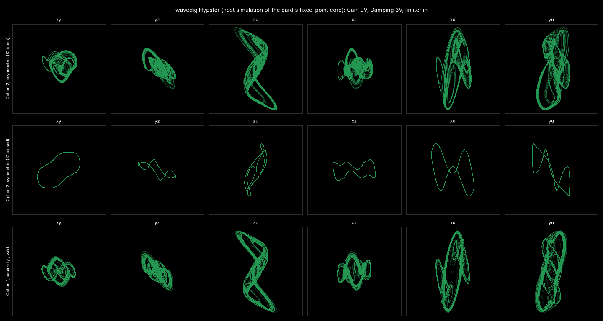

# wavedigiHypster

A wave digital filter (WDF) model of **Ian Fritz's Hypster** fourth-order
hyperchaos generator (2018), for the Music Thing Modular Workshop System
Computer.

The Hypster is four voltage-controlled integrators connected in a ring,
like an oscillating ladder filter, with zener/diode nonlinearities between
the stages. One stage has voltage-controlled gain and damping, and a
"Shape" network cross-couples x back into two of the stages. It produces
everything from simple periodic waves to dense hyperchaos, from very slow
modulation up into audio rates. This card models the circuit from Fritz's
schematics (parts 1 and 2 of *The HYPSTER Hyperchaos Generator*, Jan 2018).



*Host simulation of the card's fixed-point core: Gain 9V, Damping 3V, limiter
fitted. Compare with the Lissajous photos in Fritz's document.*

> **Status: beta, not yet tried on hardware.** It builds, and the DSP
> has been checked on the host and cycle-counted on an emulated RP2040
> (see *Verification*). Please report how it behaves on a real card.

## Panel

Tap **Z down** to step through four pages; **hold Z down** for a second
to return to page 1. Pages 2-4 briefly flash the page number on the LEDs
every two seconds. Knobs use soft takeover: after a page change a knob
does nothing until it passes the value stored for that page.

|        | Main                 | X                   | Y                     |
|--------|----------------------|---------------------|-----------------------|
| Page 1 | **Rate** (16 octaves) | **Gain** (c)        | **Damping** (b)       |
| Page 2 | Shape fat..slim      | Shape mode          | Gain trim             |
| Page 3 | Rate CV amount       | Gain CV amount      | Damping CV amount     |
| Page 4 | Output level (0-2x)  | Output map          | Rate fine (+/-1 oct)  |

**Z up** fits the optional limiter diodes D2-D4. **Z middle** leaves them
out, as Fritz did when he captured his patterns.

Shape mode (page 2 X, six zones, counter-clockwise first):

1. Option 2, asymmetric (S1 open, one diode)
2. Option 2, symmetric (S1 closed, both diodes)
3. Option 1, squirrelly / mild
4. Option 1, squirrelly / wild
5. Option 1, curly / mild
6. Option 1, curly / wild

The fat..slim knob is Option 2's R95 pot. It does nothing in the Option 1
modes.

The CV "amount" controls are attenuverters, off at the centre. Rate CV
defaults to fully clockwise, which is 1V/oct. Gain and Damping CV add to
their knobs the way the Gain Mod and Damping Mod pots do on the module.

| Input      | Function |
|------------|----------|
| CV In 1    | Rate (exponential, audio-rate capable) |
| CV In 2    | Gain mod |
| Audio In 1 | Damping mod |
| Audio In 2 | Shape fat..slim (about +/-5V covers the pot) |
| Pulse In 1 | Kick: re-seed the integrators near zero |
| Pulse In 2 | Hold: freeze the integrators while high |

| Output     | Map 1 (default) | Map 2 | Map 3 | Map 4 |
|------------|-----------------|-------|-------|-------|
| Audio Out 1 | x | x | u | y |
| Audio Out 2 | y | z | z | u |
| CV Out 1    | u | y | x | x |
| CV Out 2    | z | u | y | z |

Pulse Out 1 and 2 are comparators on the Audio Out 1 and 2 signals.
At output level 1x the op-amps' +/-10.8V swing maps onto the full +/-6V
output range. LEDs 1-4 show the four output levels and LEDs 5-6 the
pulse outputs.

### Where to start

Start on page 1 with Gain near noon and Damping a little below noon. With
Gain at zero the ring is silent. Raising Gain gives periodic orbits, then
period doubling, then chaos. Damping pulls it back toward simpler orbits.
Without the limiter (Z middle), high Gain with low Damping can latch the
system at the rails, as on the hardware: turn Gain down, or flip Z up,
to recover. Pulse In 1 kicks it too. The x-y pair (map 1) is the classic
attractor to put on a scope.

## What is modelled, and how

The RP2040 has no FPU and about 4000 cycles per 48kHz sample at 192MHz,
so effort goes where the circuit's character comes from.

**Wave digital filters, solved every sample (fixed point, core 0):**

- **The four OTA integrators** (U2/A3, U4/A9, U5/A12, U6/A15). Each is a
  WDF capacitor (port resistance T/2C) closed by a nonlinear root. The
  root is the LM13700, a current source `Iabc tanh((V- - V+)/2VT)` whose
  V+ carries the stage's own damping (and, for y and x, the Shape
  injection). One warm-started Newton step solves the root each sample.
  The result is a trapezoidal integrator of the real OTA law, tanh
  compression included, so it stays stable and in tune up to the top of
  the range. The stages run in signal order (u, z, y, x), so only the
  x -> u link and the Shape feedback carry a one-sample delay.

**Wave digital filters, solved into tables (float):**

These networks have no capacitor, so their WDF solution is a fixed
function of the input. They are solved once at boot, or on core 1
whenever Shape changes, and read through interpolated tables:

- **ZD1/ZD2 + A2** and **ZD3/ZD4 + A8**: back-to-back 4.7V zeners into
  2k2 and the amp's 33k, giving the two x - x^3-like "N" curves.
- **D6 + ZD5 + A11** and **D7 + ZD6 + A14**: the two offset breakpoint
  nonlinearities, including their 1k:1k source dividers and loading.
- **The Shape network**, both of Fritz's options: R94-R98, D8/D9, S1, S2
  and the fat/slim pot. Option 1 wild is a diode pair across R97 in a
  parallel/series WDF tree.
- **The limiter D2-D4** between the Gain and Damping control currents.

The diode roots use the closed-form Wright omega solution (Werner et
al.) plus a Newton polish. A zener in breakdown in series with a forward
junction is still one exponential law, so each zener string is a single
WDF diode with summed thermal voltages. Low-voltage zeners have a very
soft knee (they leak from about 3.5V), and that softness matters because
the A11 and A14 breakpoints sit right at the edge of the integrators'
swing.

**Behavioural (cheap and accurate enough):**

- The Rate expo converter (A7/Q3/Q4): a clean 2^x, 16 octaves, plus
  fine and CV.
- The Gain and Damping linear V-to-I converters (A5/Q1, A6/Q2), with the
  Gain trim and the R38 minimum-damping offset.
- Op-amp rail clipping (TL07x on +/-12V, about +/-10.8V), applied to the
  shaper amps (inside the tables) and as a clamp on the integrators.
- U3, the damping OTA of the u stage, is linearised. Its input is about
  13mV against tanh's 52mV knee, a 2% effect.
- The A4/A10/A13/A16 inverters, the 1k output resistors, and tiny
  op-amp noise to nudge the ring off its equilibria.

### Reading the schematic

A few values are not legible or not given, so they are chosen to agree
with Fritz's description:

- **The zener knee:** 4.7V at 5mA with a 0.35V effective thermal
  voltage, typical of 4.7V parts.
- **The Gain and Damping current ranges:** 0-0.3mA and 0.12-0.37mA,
  from the 18k emitter resistors and the summing-amp ratios. R38
  (560k) is taken to +12V, which gives the minimum damping current.
  With that reading, the model reproduces both of Fritz's notes: rail
  latch-up regions at high Gain without the limiter, and none with it.
- **The Rate range:** 4nA-262uA per OTA, which puts the x-y fundamental
  between about 0.02Hz and 1kHz.

## Verification

All of it runs on the host: `make -C test`.

- `test_wdf`: every WDF network against an independent brute-force
  nodal solution in double precision. Worst error is 61 uV across
  -12..+12V.
- `sim ref`: the fixed-point 48kHz core against a continuous-time
  reference (RK4 at 16x oversampling, double precision, on dense float
  tables of the same networks), in periodic regimes. Frequency agrees
  within about 1% up to 250Hz, -3% at 500Hz and -7% at 1kHz; RMS
  amplitude agrees within a few percent.
- `sim map <rate> <mode> <pot> [limiter]`: a regime map (quiet / periodic
  / chaotic by Lyapunov estimate / latched at the rails) over Gain x
  Damping.
- `test_card`: the real `main.cpp` against a mock ComputerCard. It
  covers paging, soft takeover, hold-to-home, the limiter switch, 1V/oct,
  output scaling, Hold and Kick.
- `tools/bench/cycles.py`: cycle-counts the real `ProcessSample` on an
  emulated Cortex-M0+ (the bench and cycle model come from
  112_Equanimity). The average is about 1450 cycles; the worst sample
  including ComputerCard's own work is about 2900 of 4000 (72%).
  The per-sample path has no float, divide or 64-bit multiply.

## Building

Pico SDK 2.x:

```sh
cmake -S . -B build -DCMAKE_BUILD_TYPE=Release
cmake --build build        # -> build/wavedigiHypster.0.1.uf2
```

The card runs at 192MHz from RAM (`copy_to_ram`), with the core voltage
raised one step, as 112_Equanimity does.

Cycle bench (needs `unicorn` and `capstone` in a Python venv):

```sh
cmake -S . -B build-bench -DCMAKE_BUILD_TYPE=Release -DHYPSTER_BENCH=ON && cmake --build build-bench
g++ -O2 -std=c++17 -Isrc tools/bench/dump_tables.cpp -o dump_tables && ./dump_tables tables.bin
venv/bin/python tools/bench/cycles.py build-bench/wavedigiHypster.elf 1.0 4000 tables.bin
```

## Files

| File | |
|------|-|
| `src/wdf.h` | Small float WDF toolkit: resistors, sources, series/parallel adaptors, polarity inverter, diode and diode-pair roots (Wright omega). |
| `src/hypster_circuit.h` | Component values and the WDF networks of every memoryless block. |
| `src/hypster_core.h` | Table building, and the fixed-point ring of four WDF integrators. |
| `src/main.cpp` | ComputerCard glue: pages, soft takeover, I/O, and core 1 Shape rebuilds. |
| `test/` | Host tests and simulator (see *Verification*). |
| `tools/bench/` | Cycle bench. |

## Credits

- Circuit, design and the name: **Ian Fritz**, *The HYPSTER Hyperchaos
  Generator* (2018). This card is a model of his circuit; please refer to
  his document for the original.
- [ComputerCard](https://github.com/TomWhitwell/Workshop_Computer) by
  Chris Johnson (`src/ComputerCard.h`, see `src/ComputerCard.LICENSE`).
- The WDF diode solution follows K. J. Werner, V. Nangia, A. Bernardini,
  J. O. Smith III, A. Sarti, *An Improved and Generalized Diode Clipper
  Model for Wave Digital Filters* (AES 2015), and the Wright omega
  approximations of S. D'Angelo et al.
- Cycle bench adapted from 112_Equanimity.

License: MIT (this card's code).
